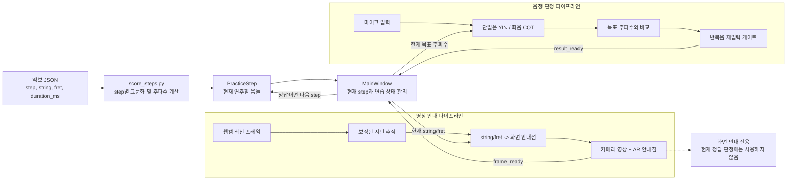
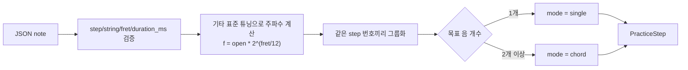
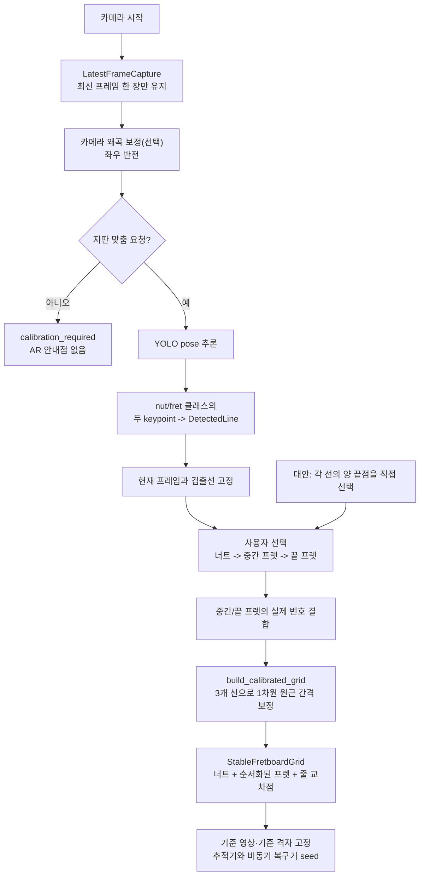
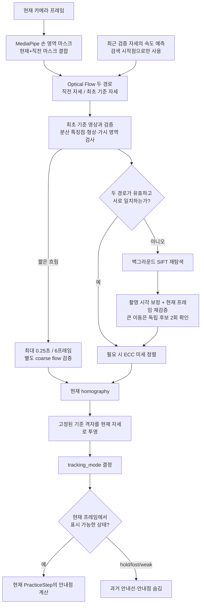
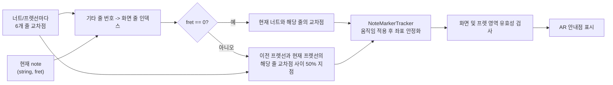
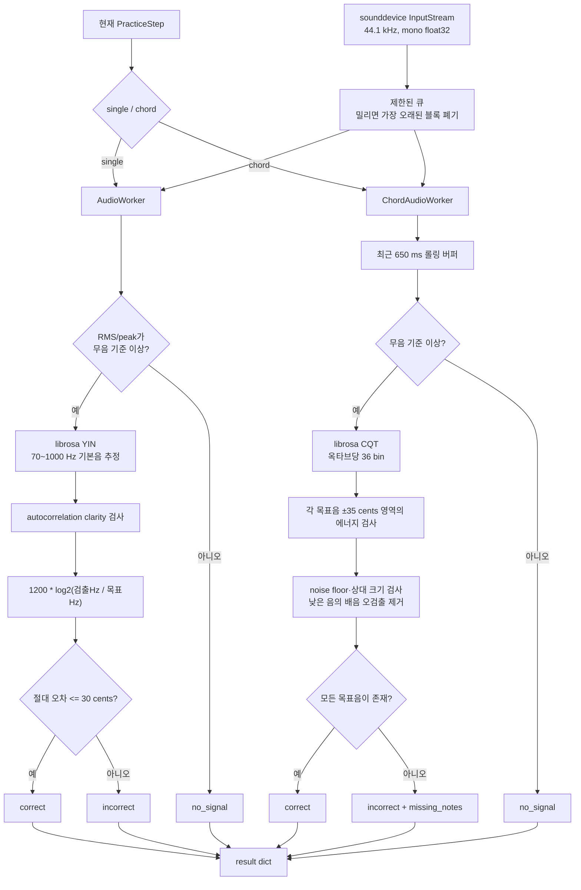
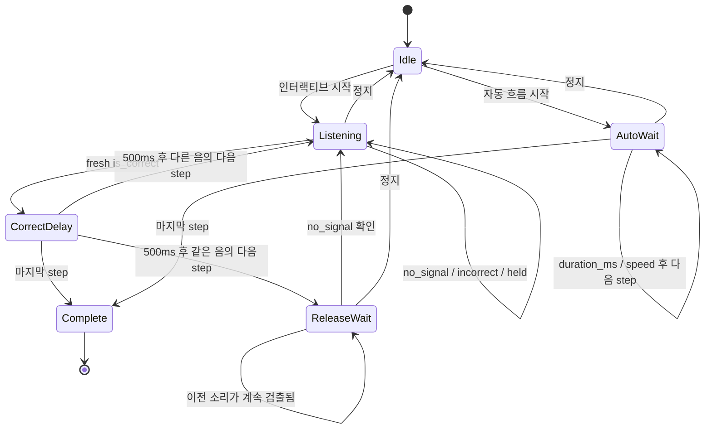
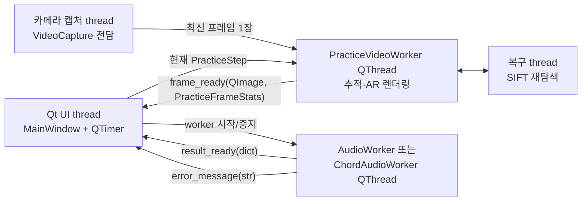

# 기타 연습 앱 파이프라인 설계

이 문서는 현재 코드의 실제 실행 흐름을 기준으로 지판 추적, 음정 인식, 정답 판정, 연습 진행의 관계를 정리합니다.

> 이 앱의 "음성 인식"은 사람의 말을 문자로 바꾸는 음성 인식(STT)이 아닙니다. 마이크에서 기타의 기본 주파수 또는 여러 목표 주파수를 찾는 **음정 인식**입니다.

## 1. 전체 구조

악보의 같은 `PracticeStep`이 영상과 오디오 파이프라인에 동시에 전달됩니다. 영상은 연주 위치를 보여주고, 오디오는 연주한 음이 맞는지 판정합니다.

핵심 경계는 다음과 같습니다.

- 영상의 안내점과 손가락 위치는 현재 정답 여부를 결정하지 않습니다.
- 인터랙티브 모드는 마이크 판정이 `is_correct=True`이고 `held=False`일 때만 다음 step으로 이동합니다.
- 자동 흐름 모드는 마이크를 사용하지 않고 `duration_ms / 배속` 시간이 지나면 이동합니다.
- 손가락 끝과 안내점 매칭 구현은 있지만 메인 앱에서는 `HAND_TRACKING_ENABLED = False`로 비활성화되어 있습니다. 지판 추적에서 손 영역을 제외하는 `HandOcclusionMasker`는 이 설정과 별개로 계속 사용합니다.

## 2. 악보 데이터 파이프라인

`PracticeStep`은 양쪽 파이프라인이 공유하는 기준 데이터입니다.

| 필드 | 의미 | 소비자 |
| --- | --- | --- |
| `step` | 악보의 진행 번호 | `MainWindow`, 악보 UI |
| `notes[].string_number` | 기타 줄 번호 1~6 | 지판 안내점 계산 |
| `notes[].fret_number` | 프렛 번호, 0은 개방현 | 지판 안내점 계산 |
| `expected_frequencies` | 각 음의 이름과 목표 Hz | 오디오 워커 |
| `duration_ms` | 해당 step의 표시 시간 | 자동 흐름 모드 |

## 3. 지판 보정 및 추적

### 3.1 최초 지판 맞춤

보정 격자는 다음 순서로 생성됩니다.

1. 너트와 끝 프렛으로 지판 사각 영역을 정규화합니다.
2. 중간 프렛의 실제 번호와 화면 위치로 길이 방향의 원근 왜곡을 계산합니다.
3. 기타의 프렛 비율 `1 - 2^(-fret/12)`로 너트부터 끝 기준 프렛까지 모든 프렛선을 복원합니다.
4. 너트와 각 프렛선 위에 6개의 등간격 줄 좌표를 만들어 줄별 교차 좌표로 사용합니다.

### 3.2 매 프레임 추적

보정 후 메인 앱은 YOLO 검출로 지판 형상이나 프렛 번호를 다시 쓰지 않습니다. YOLO는 최초 맞춤용이며, 런타임 지판 좌표는 고정된 기준 격자와 현재 영상의 대응 관계로 계산됩니다.

| `tracking_mode` | 의미 | AR 표시 |
| --- | --- | --- |
| `calibration_required` | 아직 지판을 맞추지 않음 | 숨김 |
| `selected_lines_reference_weak` | 기준 영상 특징이 부족함 | 숨김 |
| `selected_lines_motion` | 현재 영상에서 정상 이동 추적 | 표시 |
| `selected_lines_continuity` | 짧은 흐림 중 별도 대응점으로 현재 위치 확인 | 표시 |
| `selected_lines_reacquired` | 기준 영상으로 재탐색 성공 | 표시 |
| `selected_lines_hold` | 마지막 격자만 내부에 남고 현재 위치는 미검증 | 숨김 |
| `selected_lines_lost` | 격자를 잃음 | 숨김 |

### 3.3 프렛 중심 안내점 계산

여기서 “중심점”은 모델이 직접 예측하는 별도 keypoint가 아닙니다. 모델/보정으로 얻은 프렛 경계와 줄 위치의 관계에서 계산한 **프렛 칸 중심 좌표**입니다. 현재 손으로 가린 안내점도 지판 자세가 검증되었다면 보이도록 `hide_occluded=False`를 사용합니다.

## 4. 음정 인식 및 정답 판정

### 단일음 판정

- 기본 입력 블록은 4096 sample, 결과 갱신 간격은 50ms입니다.
- RMS와 peak가 무음 기준보다 작으면 주파수를 판정하지 않습니다.
- YIN이 찾은 주파수의 선명도를 다시 검사하고, 목표음과의 오차가 기본 `±30 cents` 이내이면 정답입니다.
- 마지막 유효 결과는 최대 900ms 동안 `held=True`로 화면에 유지되지만, 유지 결과만으로 다음 step으로 넘어가지는 않습니다.

### 화음 판정

- 기본 입력 블록은 2048 sample이며 최근 650ms를 모아 120ms 간격으로 분석합니다.
- 일반 화음 이름을 추측하는 방식이 아니라, 현재 step에 이미 지정된 목표 주파수들이 존재하는지만 검사합니다.
- 각 목표음은 기본 `±35 cents`, 최대 에너지 대비 `-30dB` 이상, noise floor 대비 `+10dB` 이상이어야 합니다.
- 강한 저음의 배음을 별도 음으로 잘못 인정하지 않도록 배음 후보를 제거합니다.
- 목표음이 모두 검출되어야 정답이며, 빠진 음은 `missing_notes`로 UI에 전달됩니다.
- 마지막 정답은 최대 600ms 동안 화면에 유지되지만 `held=True` 결과는 진행 조건에서 제외됩니다.

### 현재 판정 범위

- 단일음은 주파수만 비교하므로, 같은 음높이를 다른 줄·프렛에서 연주해도 정답으로 처리될 수 있습니다.
- 화음은 목표음이 모두 있는지 검사하며, 목표 외의 음이 함께 들어왔다는 이유만으로 오답 처리하지는 않습니다.
- 인터랙티브 모드는 음의 시작 시각이나 길이를 채점하지 않고, 현재 step의 목표음 검출 여부로 진행합니다.
- 영상에서 계산한 손가락 위치와 오디오 정답을 결합하지 않으므로 “올바른 줄·프렛을 눌렀는가”는 현재 판정 범위 밖입니다.

## 5. 연습 진행 상태

같은 목표 주파수 조합이 연속되는 경우 `RetriggerGate`가 중간의 `no_signal`을 기다립니다. 따라서 길게 유지한 한 번의 소리가 반복음 두 개를 모두 통과시키지 않습니다.

| 모드 | 다음 step 조건 | 영상 결과 사용 여부 |
| --- | --- | --- |
| 인터랙티브 | 새 오디오 결과가 정답이고 `held=False`, 이후 500ms | 사용 안 함 |
| 자동 흐름 | `duration_ms / speed_multiplier` 경과 | 사용 안 함 |
| 이전/다음 버튼 | 사용자 입력 | 사용 안 함 |

## 6. 스레드와 신호 경계

- 카메라 프레임은 쌓지 않고 아직 처리하지 않은 최신 한 장으로 교체합니다.
- 카메라 장치는 캡처 thread만 열고 읽고 닫습니다.
- 영상 및 오디오 워커는 UI를 직접 수정하지 않고 Qt signal로 결과를 보냅니다.
- 인터랙티브 모드에서 step이 바뀌면 기존 오디오 워커를 중지하고 해당 step에 맞는 단일음/화음 워커를 새로 시작합니다.

## 7. 주요 데이터 계약

| 형식 | 생성 위치 | 핵심 내용 | 사용 위치 |
| --- | --- | --- | --- |
| `PracticeStep` | `practice/score_steps.py` | 현재 step의 줄, 프렛, 목표 Hz, 시간 | 영상·오디오 공통 입력 |
| `DetectedLine` | YOLO 변환 또는 수동 선택 | 종류, 두 끝점, confidence | 최초 지판 보정 |
| `StableFretboardGrid` | `vision/fretboard_calibration.py` | 너트, 순서화된 프렛선, 6줄 교차점 | 추적 및 안내점 계산 |
| `NoteMarker` | `app/practice_markers.py` | 줄 인덱스, 프렛 인덱스, 화면 좌표 | AR 렌더링 |
| 단일음 결과 `dict` | `audio/audio_worker.py` | 검출 Hz, cents, 상태, 정답, held | UI 및 진행 판정 |
| 화음 결과 `dict` | `audio/chord_audio_worker.py` | 음별 match, 누락음, 상태, 정답, held | UI 및 진행 판정 |
| `PracticeFrameStats` | `app/features/video.py` | FPS, 추적 상태, 격자, marker 수 | 카메라 UI 및 진단 |

## 8. 책임 경계

- `app/main.py`: 실행 인자 해석과 `MainWindow` 생성만 담당합니다.
- `app/ui/main_window.py`: 영상·오디오·악보 상태를 연결하고 다음 step 이동을 결정합니다.
- `app/features/video.py`: 카메라 프레임에서 검증된 지판 자세와 AR 영상을 만듭니다.
- `vision/`: 보정 격자, 이동 추적, 기준 영상 검증, 재탐색을 담당합니다.
- `app/practice_markers.py`: `(string, fret)`을 화면 안내점으로 변환합니다.
- `app/features/practice_audio.py`: step에 맞는 워커 선택과 반복음 게이트를 담당합니다.
- `audio/`: 실제 신호 분석과 음정 정답 여부를 계산합니다.
- `practice/score_steps.py`: 악보 JSON을 영상·오디오가 공유할 `PracticeStep`으로 변환합니다.

따라서 향후 “손가락 위치까지 맞아야 정답” 정책을 추가하려면 영상의 `matched_marker_indices`와 오디오의 `is_correct`를 결합하는 별도 판정 계층이 필요합니다. 현재 구조에는 이 결합 판정이 없습니다.
