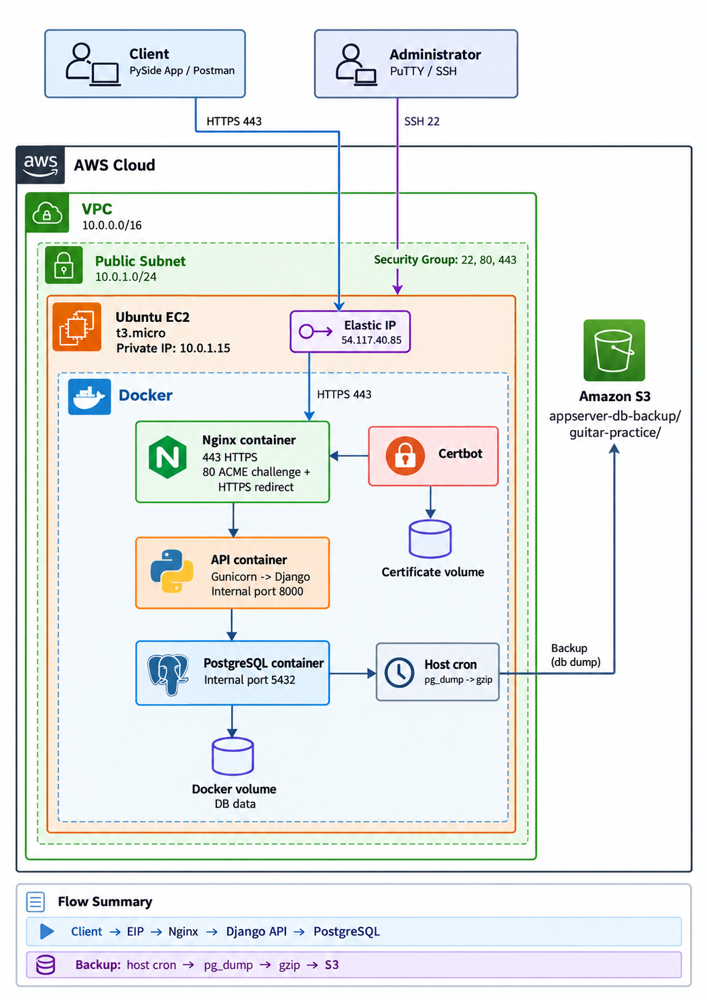
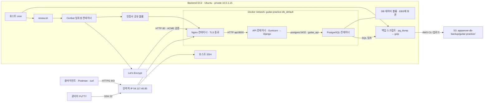

# 현재 서버 구성

작성 기준: 2026-10-05. 저장소의 Compose 설정과 사용자가 확인한 서버 실행 결과를 정리했습니다.
AWS 콘솔·서버에 직접 접속해 조사한 인벤토리는 아닙니다. 최신 확인 결과는 EIP를 통한 두 health 요청 모두 HTTP 200입니다.

## 1. 전체 연결 구조



그림의 `Host cron`은 실제로 Docker 컨테이너 밖의 EC2 호스트에서 실행됩니다.
Certbot은 인증서 공유 볼륨에 기록하고, Nginx는 해당 볼륨을 읽어 인증서를 적용합니다.
그림의 VPC·서브넷 CIDR은 AWS 콘솔 설정과 대조하여 확인합니다.



Nginx·API·DB는 같은 EC2에서 각각 별도 컨테이너로 실행합니다.
Certbot과 migrate는 필요할 때 실행하는 도구이며 상시 서비스가 아닙니다.
PySide 화면의 서버 연동은 별도 개발 대상입니다. API·Postman 검증 완료와 앱 연동 완료는 구분합니다.

## 2. 서버 기본 정보

| 항목 | 현재 구성 |
| --- | --- |
| 외부 API 주소 | `https://54.117.40.85` |
| IP 방식 | Elastic IP. 할당·연결 유지 시 중지 후 시작해도 같은 주소 사용 |
| 프라이빗 IP | `10.0.1.15` |
| 인스턴스 | 기존 확인 기준 t3.micro, Ubuntu. 세부 OS 버전·리전·인스턴스 ID는 콘솔에서 확인 |
| 저장소 | `/home/ubuntu/Guitar_Practice_Support_SW` |
| 배포 브랜치 | `feat/server-integration` |
| 서버 반영 확인 커밋 | `7aa19b8d` — 이후 배포 시 서버의 `git log -1 --oneline`으로 확인 |
| 실행 단위 | `db/`, `api/`, `nginx/`의 Compose 프로젝트 3개 |

기존 별도 DB EC2의 삭제·중지 여부는 이 문서에서 확인하지 못했습니다.
현재 서비스 구성에는 포함하지 않으며, 남아 있다면 AWS 콘솔에서 사용·과금 여부를 별도 확인합니다.

## 3. 컨테이너와 포트

| 역할 | Compose 프로젝트 / 서비스 | 이미지·실행 | 호스트 포트 |
| --- | --- | --- | --- |
| HTTPS 프록시 | `guitar-practice-https` / `nginx` | `nginx:1.28-alpine` | `80`, `443` |
| API | `guitar-practice-api` / `api` | Python 3.12 기반 빌드, Gunicorn worker 1개 | `127.0.0.1:8000` |
| DB | `guitar-practice-db` / `postgres` | `postgres:16-alpine` | `127.0.0.1:5432` |
| 인증서 발급·갱신 | `guitar-practice-https` / `certbot` | `certbot/certbot:v5.4.0`, tools profile | 없음 |
| DB 관리 | `guitar-practice-db` / `migrate` | `postgres:16-alpine`, tools profile | 없음 |

API·Nginx는 DB Compose가 생성한 `guitar-practice-db_default` 네트워크를 공유합니다.
컨테이너끼리는 서비스 이름으로 접근하므로 EIP를 내부 DB·API 주소에 넣지 않습니다.
각 컨테이너의 `127.0.0.1`은 자기 자신이며 다른 컨테이너를 가리키지 않습니다.

보안 그룹 운영 기준: SSH 22는 관리자 IP, HTTP 80은 인증서 검증용 외부 접근,
HTTPS 443은 클라이언트 접근 허용. 8000·5432는 외부에 열지 않습니다.
현재 보안 그룹의 정확한 규칙 값은 AWS 콘솔에서 확인해야 합니다.

## 4. 설정·데이터 위치

| 위치 | 용도 |
| --- | --- |
| `api/.env.local` | Django 비밀키, 허용 Host, DB 접속 정보, Google OAuth client ID |
| `db/.env.local` | DB 초기화 계정·API role 비밀번호 |
| `nginx/.env` | 운영값 `NGINX_CONFIG=https.conf` |
| `nginx/https.conf` | HTTP → HTTPS 리다이렉트, 인증서 경로, API 프록시 |
| `nginx/renew.sh` | 인증서 갱신 후 Nginx 검사·reload |
| `db/scripts/backup_db_to_s3.sh` | SQL 덤프·압축 검사·S3 업로드 |
| `db/scripts/restore_db_from_s3.sh` | S3 백업 선택 후 DB 복원 |

환경 파일·토큰·인증서 개인키는 Git에 넣지 않습니다.
API의 `DJANGO_ALLOWED_HOSTS`는 `127.0.0.1,localhost,54.117.40.85`를 사용합니다.
DB 이름은 `guitar_practice`, API 접속 계정은 `guitar_api`, 관리·덤프 계정은 `guitar_migrator`입니다.

| 저장 대상 | Compose 볼륨 키 / 저장 경로 |
| --- | --- |
| PostgreSQL | `guitar_practice_postgres_data` → 컨테이너 `/var/lib/postgresql/data`, PGDATA는 그 아래 `pgdata` |
| 인증서·갱신 설정 | `certificates` → `/etc/letsencrypt` |
| ACME 검증 파일 | `challenges` → `/var/www/certbot` |
| 로컬 백업 | 백업 실행 계정의 `$HOME/backups/guitar-practice` |
| 원격 백업 | `s3://appserver-db-backup/guitar-practice/` |

볼륨의 실제 Docker 이름에는 Compose 프로젝트 접두사가 붙습니다. `sudo docker volume ls`로 확인합니다.
컨테이너 재생성과 데이터 삭제는 다릅니다. 운영 볼륨을 지우는 `docker compose down -v`는 실행하지 않습니다.

## 5. 인증서·백업 운영

인증서 이름은 `backend`, Nginx는 `/etc/letsencrypt/live/backend/fullchain.pem`과 `privkey.pem`을 읽습니다.
새 EIP용 인증서 적용과 HTTPS 정상 응답을 확인했습니다. EIP를 사용해도 단기 인증서 갱신은 계속 필요합니다.
안내한 갱신 일정은 root cron의 `17 */6 * * *`이며, 현재 등록 여부는 `sudo crontab -l`로 확인합니다.
갱신 로그 경로는 `/var/log/guitar-practice-certbot.log`입니다.

백업 스크립트는 `.sql.gz`를 생성하고 `gzip -t` 통과 후 S3에 업로드합니다.
이 검사는 압축 손상을 확인하며 실제 복원 성공을 보장하지 않습니다.
현재 통합 서버의 백업 cron 등록 경로·시간은 `crontab -l`로 재확인해야 합니다.
스크립트는 `$HOME`을 사용하므로 ubuntu 계정 기준으로 운영합니다. root 실행 시 경로가 달라집니다.
백업 파일 자동 보관 기한·삭제와 갱신 로그 순환 설정은 코드에 포함되어 있지 않습니다.

## 6. 재시작·일상 점검

EC2 중지 중에는 API·DB·백업·갱신 작업이 모두 멈춥니다.
시작 후 Docker 서비스가 실행 중이어야 하며, 서비스에는 `restart: unless-stopped`가 설정되어 있습니다.
직접 중지해 둔 컨테이너는 필요 시 DB → API → Nginx 순으로 각 폴더에서 `docker compose up -d`를 실행합니다.

```bash
cd ~/Guitar_Practice_Support_SW
# 현재 배포 커밋과 서비스 상태를 확인합니다.
git log -1 --oneline
sudo docker compose -f db/docker-compose.yml ps
sudo docker compose -f api/docker-compose.yml ps
sudo docker compose -f nginx/docker-compose.yml ps

# 중지 중 만료되었을 수 있는 인증서를 갱신하고 Nginx에 반영합니다.
sudo bash nginx/renew.sh

# 인증서 검증을 유지한 채 전체 연결을 확인합니다.
curl -i https://54.117.40.85/health/
curl -i https://54.117.40.85/health/db/
```

두 응답이 200이면 HTTPS → Django 및 DB 연결은 정상입니다.
`/health/db/`는 SELECT 1 검사이므로 업무 테이블·실제 업로드 검증은 [API의 Postman 안내](../api/README.md#postman)를 사용합니다.
최초 구축·인증서 재발급은 [Nginx 문서](../nginx/README.md), DB 작업은 [DB 문서](../db/README.md)를 참고하세요.

현재 단일 EC2 구성은 서버 중지·장애 시 전체 서비스가 중단됩니다. 자동 장애 전환 구성은 없습니다.
