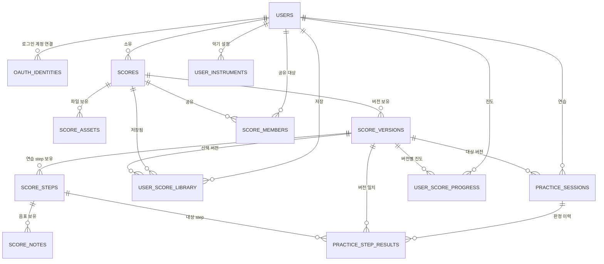

# 데이터베이스 ERD와 연동 규칙

## 관계 개요

상세 관계는 [DBML 원본](database-erd.dbml)에서 확인할 수 있습니다.

## 현재 JSON 악보와의 매핑

| 현재 JSON 필드 | 저장 위치 | 설명 |
| --- | --- | --- |
| 루트 `title` | `scores.title` | 사용자에게 보이는 악보 제목 |
| `step` | `score_steps.sequence_no` | 연습 순서. 같은 번호의 음표는 화음 |
| `score_line` | `score_steps.score_line` | 탭 악보 표시 줄 |
| `measure` | `score_steps.measure_no` | 마디 번호 |
| `beat` | `score_steps.beat_no` | 마디 내 박자 번호 |
| `duration_ms` | `score_steps.duration_ms` | 자동 흐름에서의 유지 시간 |
| `string` | `score_notes.string_number` | 1~6번 기타 줄 |
| `fret` | `score_notes.fret_number` | 0~30 프렛 |
| `midi_pitch` | `score_notes.midi_pitch` | MIDI 음고 |

## 공통 규칙

- 모든 `id`는 UUID 기본 키입니다.
- `created_at`은 생성 시각, `updated_at`은 마지막 수정 시각입니다. `updated_at`이 있는 테이블은 수정할 때 자동으로 현재 시각으로 갱신됩니다.
- `user_id`, `score_id`처럼 `_id`로 끝나는 컬럼은 다른 테이블의 레코드를 참조하는 외래 키입니다.
- `deleted_at`이 있는 테이블은 실제로 행을 바로 지우지 않고, 삭제 시각을 기록하는 소프트 삭제를 기본으로 사용합니다.
- 열거형 값은 데이터베이스의 `CHECK` 제약 조건으로 제한해 잘못된 상태값이 저장되지 않게 합니다.

## 테이블 상세

### 회원과 OAuth

#### `users` — 서비스 내부 회원 프로필

| 컬럼 | 의미 |
| --- | --- |
| `id` | 서비스 내부 회원 ID. 모든 개인 데이터의 기준 키 |
| `display_name` | 서비스 화면에 표시할 이름 |
| `role` | 권한. `user` 또는 `admin` |
| `status` | 계정 상태. `active`, `suspended`, `deleted` |
| `terms_version`, `terms_agreed_at` | 동의한 이용약관 버전과 동의 시각 |
| `privacy_policy_version`, `privacy_policy_agreed_at` | 동의한 개인정보처리방침 버전과 동의 시각 |
| `last_login_at` | 마지막 로그인 시각 |
| `created_at`, `updated_at` | 회원 생성·수정 시각 |
| `deleted_at` | 탈퇴 처리 시각 |

#### `oauth_identities` — 외부 로그인 계정 연결

| 컬럼 | 의미 |
| --- | --- |
| `id` | OAuth 계정 연결 ID |
| `user_id` | 연결된 내부 회원 `users.id` |
| `provider` | OAuth 제공자. 예: `google`, `kakao`, `naver`, `apple` |
| `provider_subject` | OIDC `sub` 등 제공자가 보장하는 고유 식별자 |
| `email`, `email_verified` | 제공받은 이메일과 제공자 인증 여부. 이메일은 없거나 바뀔 수 있음 |
| `linked_at` | 외부 계정을 연결한 시각 |
| `last_authenticated_at` | 해당 계정으로 마지막 인증한 시각 |
| `created_at`, `updated_at` | 연결 정보 생성·수정 시각 |

`(provider, provider_subject)`는 유일함 따라서 같은 외부 계정은 하나의 내부 회원에만 연결

### 악보와 파일

#### `scores` — 악보의 기본 정보와 소유권

| 컬럼 | 의미 |
| --- | --- |
| `id` | 악보 ID |
| `owner_user_id` | 악보를 만들거나 소유한 회원 |
| `title`, `description` | 악보 제목과 설명 |
| `visibility` | 공개 범위. `private`, `unlisted`, `public` |
| `source_type` | 생성 방식. `guitar_pro`, `image`, `manual`, `sample`, `import` |
| `parser_status` | 변환 상태. `pending`, `processing`, `ready`, `failed` |
| `parser_error` | 변환 실패 시 오류 원인 |
| `created_at`, `updated_at`, `deleted_at` | 생성·수정·소프트 삭제 시각 |

#### `score_assets` — 실제 파일의 메타데이터

| 컬럼 | 의미 |
| --- | --- |
| `id`, `score_id` | 파일 ID와 소속 악보 |
| `asset_type` | 파일 종류. `original_file`, `parsed_json`, `score_image`, `thumbnail` |
| `storage_provider`, `storage_key` | 파일 저장소(`s3` 또는 `local`)와 내부 경로/key |
| `original_filename` | 사용자가 올린 원래 파일명 |
| `content_type`, `byte_size` | MIME 타입과 파일 크기 |
| `checksum_sha256` | 파일 무결성 확인용 SHA-256 해시 |
| `created_at` | 파일 메타데이터 생성 시각 |

파일의 실제 바이트는 DB가 아닌 S3 또는 서버 파일 저장소에 둡니다.

#### `score_versions` — 악보 수정 이력

| 컬럼 | 의미 |
| --- | --- |
| `id`, `score_id` | 악보 버전 ID와 원본 악보 |
| `version_number` | 같은 악보 안에서의 버전 번호. `1`, `2`, `3` 순서 |
| `source_asset_id` | 이 버전을 만들 때 사용한 원본 또는 변환 파일 |
| `created_by_user_id` | 버전을 생성한 회원 |
| `parser_name`, `parser_version` | 변환기 이름과 버전 |
| `note_count`, `step_count` | 음표 수와 연습 step 수의 요약값 |
| `created_at` | 버전 생성 시각 |

연습 기록은 `scores.id`가 아닌 `score_versions.id`를 참조함. 따라서 악보를 수정해 새 버전을 만들어도 과거 연습 기록은 바뀌지 않음.

#### `score_steps` — 연습 진행 단위

| 컬럼 | 의미 |
| --- | --- |
| `id`, `score_version_id` | step ID와 소속 악보 버전 |
| `sequence_no` | 연습 순서. 같은 번호의 음표는 동시에 연주하는 화음 |
| `score_line` | 탭 악보 표시 줄 번호 |
| `measure_no`, `beat_no` | 마디 번호와 마디 안의 박자 번호 |
| `duration_ms` | 자동 흐름 모드에서 이 step을 유지할 시간(ms) |
| `created_at` | step 생성 시각 |

#### `score_notes` — step 안의 개별 음표

| 컬럼 | 의미 |
| --- | --- |
| `id`, `score_step_id` | 음표 ID와 소속 step |
| `string_number` | 기타 줄 번호. 1~6번 줄 |
| `fret_number` | 프렛 번호. 0~30프렛 |
| `midi_pitch` | 음고를 나타내는 MIDI 값. 0~127 범위 |
| `created_at` | 음표 생성 시각 |

같은 step에는 같은 줄의 음표를 두 번 넣을 수 없도록 제한

#### `score_members` — 개별 악보 공유 권한

| 컬럼 | 의미 |
| --- | --- |
| `score_id`, `user_id` | 공유할 악보와 공유받는 회원 |
| `permission` | 권한. `viewer` 또는 `editor` |
| `added_by_user_id` | 공유를 추가한 회원 |
| `added_at` | 공유한 시각 |

#### `user_score_library` — 회원별 개인 악보함

| 컬럼 | 의미 |
| --- | --- |
| `user_id`, `score_id` | 회원이 저장한 악보 |
| `saved_score_version_id` | 저장했거나 마지막으로 선택한 악보 버전 |
| `is_favorite` | 즐겨찾기 여부 |
| `saved_at`, `last_opened_at` | 저장·마지막 열람 시각 |
| `updated_at` | 악보함 정보 마지막 수정 시각 |

### 연습과 통계

#### `user_instruments` — 회원의 기타 설정

| 컬럼 | 의미 |
| --- | --- |
| `id`, `user_id` | 악기 설정 ID와 소유 회원 |
| `label` | 예: `표준 기타`, `드롭 D 기타` |
| `string_count` | 줄 수. 기본값은 6, 최대 12 |
| `tuning_midi` | 줄별 튜닝을 담은 MIDI 배열. 기본은 표준 기타 튜닝 |
| `is_default` | 해당 회원의 기본 악기 여부 |
| `created_at`, `updated_at` | 설정 생성·수정 시각 |

한 회원은 여러 악기 설정을 가질 수 있지만, 기본 악기는 하나만 둘 수 있음.

#### `practice_sessions` — 한 번의 연습 실행

| 컬럼 | 의미 |
| --- | --- |
| `id`, `user_id` | 연습 세션 ID와 연습한 회원 |
| `score_version_id` | 연습한 악보 버전 |
| `mode` | 연습 방식. `interactive` 또는 `auto` |
| `status` | 세션 상태. `in_progress`, `completed`, `abandoned` |
| `speed_multiplier` | 자동 흐름 모드의 배속. 기본 `1.00` |
| `started_step_no` | 연습을 시작한 step 번호 |
| `completed_step_count`, `correct_step_count` | 완료한 step 수와 정답 step 수 |
| `client_version` | 연습에 사용한 데스크톱 앱 버전 |
| `started_at`, `ended_at` | 연습 시작·종료 시각 |
| `created_at`, `updated_at` | 세션 레코드 생성·수정 시각 |

`correct_step_count`는 `completed_step_count`보다 클 수 없도록 제한함.

#### `practice_step_results` — step별 판정 이력

| 컬럼 | 의미 |
| --- | --- |
| `id`, `practice_session_id` | 판정 결과 ID와 소속 연습 세션 |
| `score_version_id`, `score_step_id` | 판정한 악보 버전과 step |
| `attempt_no` | 같은 step에서의 시도 번호 |
| `outcome` | `correct`, `incorrect`, `skipped`, `timeout` |
| `elapsed_ms` | 해당 시도에 걸린 시간(ms) |
| `retrigger_required` | 같은 음 반복으로 소리를 끊고 다시 연주해야 했는지 |
| `detection_summary` | 감지 주파수·판정 상태 등 원본 미디어를 제외한 요약 JSON |
| `recorded_at` | 결과 기록 시각 |

세션의 악보 버전과 결과의 step이 같은 버전에 속하는지 외래 키로 검증.

#### `user_score_progress` — 사용자별 진도 요약

| 컬럼 | 의미 |
| --- | --- |
| `user_id`, `score_version_id` | 회원과 악보 버전의 조합 |
| `last_completed_step_no` | 마지막으로 완료한 step 번호 |
| `best_accuracy_percent` | 해당 버전에서 기록한 최고 정확도. 0~100 |
| `last_practiced_at` | 마지막 연습 시각 |
| `created_at`, `updated_at` | 진도 생성·수정 시각 |

이 테이블은 세션별 상세 기록을 매번 집계하지 않고, 목록 화면에서 빠르게 진도를 보여 주기 위한 요약 데이터임.

## OAuth 로그인 처리 기준

1. 앱은 시스템 브라우저에서 OAuth/OIDC Authorization Code + PKCE 흐름을 시작합니다.
2. 로그인 담당 서버는 제공자 토큰을 검증합니다.
3. 서버는 `(provider, provider_subject)`로 `oauth_identities`를 조회합니다.
4. 조회 결과가 없으면 `users`와 `oauth_identities`를 한 트랜잭션에서 생성합니다.
5. 서버가 발급한 서비스용 JWT의 내부 `users.id`를 이후 API 권한 검사 기준으로 사용합니다.

이메일은 제공되지 않거나 변경될 수 있으므로 회원 식별 및 계정 연결의 기준으로 사용하지 않습니다.

## 접근 권한 기준

- `scores.owner_user_id`가 악보의 기본 관리자입니다.
- `visibility = private`는 소유자와 `score_members`만 접근합니다.
- `visibility = unlisted`는 공유 링크 정책을 API에서 추가로 검사합니다.
- `visibility = public`은 공개 목록에 노출할 수 있습니다.
- API는 회원 상태가 `active`인지와 악보 소유/공유 권한을 매 요청마다 확인합니다.
- `scores.deleted_at`이 설정된 악보는 일반 목록과 API 응답에서 제외합니다.

## 의도적으로 저장하지 않는 데이터

- OAuth 비밀번호, client secret, access token, refresh token
- 마이크 원본 녹음, 카메라 원본 영상
- 임시 카메라 보정값과 마이크 장치 식별자

원본 악보 파일과 변환 JSON은 `score_assets`의 메타데이터로만 참조하며, 실제 바이트는 S3 또는 서버의 별도 파일 저장소에 둡니다.
